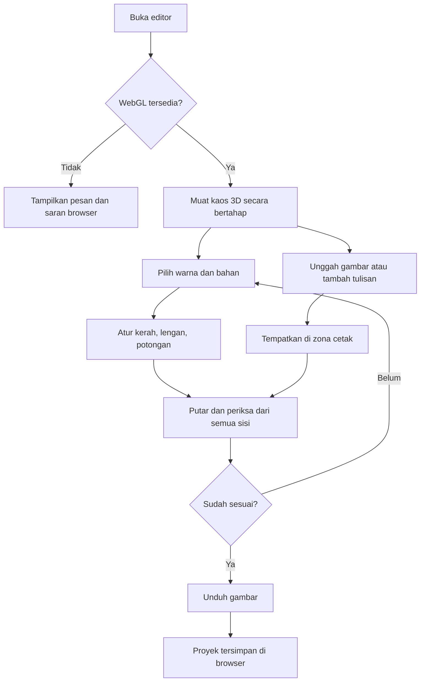

# 04. PRD dan User Story (Fase 1)

| | |
|---|---|
| Versi | 0.1 (draf) |
| Tanggal | 13 November 2026 |
| Cakupan | Fase 1 (MVP) berdasarkan katalog fitur di dokumen 03 |
| Catatan | Angka bertanda [TARGET] adalah sasaran awal untuk diuji ulang setelah spike teknis. Tidak ada angka di sini yang merupakan klaim tentang kenyataan. |

## 1. Tujuan Fase 1

Memberi pengguna satu editor kaos 3D yang bisa langsung dipakai tanpa akun, dengan kontrol atas warna, gambar, teks, bahan, kerah, lengan, dan potongan, serta menghasilkan gambar PNG dan JPG tanpa watermark.

**Keberhasilan Fase 1** (rincian di dokumen 06): pengguna baru bisa sampai ke unduhan pertama dalam beberapa menit tanpa bantuan, editor lancar di ponsel kelas menengah, dan hipotesis G1 sampai G3 mulai terbukti atau terbantahkan dengan data.

### Fitur dalam cakupan (32 fitur)

| Modul | Fitur Fase 1 |
|---|---|
| A. Pratinjau 3D | A1 Pratinjau langsung, A2 Putar dan zoom, A3 Sudut kamera, A4 Layar penuh, A5 Pencahayaan, A6 Latar |
| B. Warna | B1 Warna kaos, B2 Warna tiap bagian, B3 Palet siap pakai |
| C. Gambar | C1 Unggah, C2 Zona cetak, C3 Ukuran dan posisi, C4 Ukuran cetak dan peringatan resolusi |
| D. Teks | D1 Tambah tulisan, D2 Pilihan font, D3 Susunan teks |
| E. Bahan | E1 Pilihan bahan (4), E2 Ketebalan visual, E5 Catatan akurasi |
| F. Detail model | F1 Kerah (bulat, V, scoop), F2 Lengan (pendek, tiga perempat, panjang), F3 Potongan dan panjang |
| G. Proyek | G1 Simpan otomatis, G2 Undo dan redo |
| H. Ekspor | H1 Unduh gambar |
| I. Pengalaman | I1 Tanpa akun, I2 Bahasa Indonesia, I3 Ponsel, I4 Aksesibilitas, I5 Kualitas adaptif, I6 Keadaan kosong, memuat, gagal, I7 Privasi bawaan |

## 2. Alur pengguna utama

## 3. User story dan kriteria penerimaan

Format kriteria: Diberikan (kondisi awal), Ketika (aksi), Maka (hasil yang bisa diuji).

### Pratinjau dan kamera

**US-01 (A1) Melihat kaos langsung.**
Sebagai pengguna baru, saya ingin kaos 3D langsung tampil saat editor terbuka, supaya saya tahu alat ini bekerja.
- Diberikan editor dibuka pertama kali, ketika model selesai dimuat, maka kaos polos tampil di tengah dengan bayangan dan semua panel aktif.
- Diberikan model masih dimuat, maka tampil indikator kemajuan dan teks "Menyiapkan kaos 3D".
- Kaos pertama tampil dalam [TARGET: 3 detik] pada koneksi 4G tipikal dan perangkat kelas menengah.

**US-02 (A2) Memutar dan memperbesar.**
- Diberikan kaos tampil, ketika saya menyeret dengan mouse atau satu jari, maka kaos berputar mengikuti.
- Ketika saya menggulir roda mouse atau mencubit dua jari, maka tampilan memperbesar atau memperkecil dalam batas yang ditentukan.
- Ketika saya menekan "Atur Ulang Kamera", maka kamera kembali ke tampilan awal.
- Gestur di kanvas tidak menggulir halaman.

**US-03 (A3) Pindah sudut.**
- Ketika saya memilih preset (depan, belakang, samping kiri, samping kanan, tiga perempat, close-up kerah, close-up lengan), maka kamera berpindah halus ke sudut itu dalam kurang dari satu detik.

**US-04 (A5, A6) Cahaya dan latar.**
- Ketika saya memilih preset cahaya, maka tampilan kaos berubah dan slider intensitas aktif.
- Ketika saya memilih latar transparan, maka kanvas menampilkan pola kotak-kotak dan ekspor PNG menyimpan latar transparan.
- Ketika saya mengunggah gambar latar, maka gambar menutupi seluruh latar tanpa terdistorsi.

### Warna

**US-05 (B1) Mengganti warna kaos.**
- Ketika saya memilih warna dari palet, mengetik kode heksadesimal valid, atau memakai pipet, maka seluruh badan kaos berganti warna seketika.
- Diberikan kode warna tidak valid, maka kolom menandai kesalahan dan warna kaos tidak berubah.
- Warna terakhir yang dipakai muncul di riwayat warna.

**US-06 (B2) Mewarnai bagian terpisah.**
- Ketika saya membuka pilihan bagian dan memilih satu bagian (badan, lengan, rib kerah), maka perubahan warna hanya memengaruhi bagian itu.
- Ketika saya menekan "Samakan Semua Bagian", maka semua bagian memakai warna bagian yang sedang dipilih.

### Gambar dan teks

**US-07 (C1) Mengunggah gambar.**
- Ketika saya menyeret atau memilih berkas PNG, JPG, WebP, atau SVG yang valid, maka gambar tampil di zona cetak yang dipilih.
- Ketika berkas tidak didukung, terlalu besar (lebih dari [KEPUTUSAN: batas ukuran]), atau rusak, maka tampil pesan yang menyebut penyebab dan langkah berikutnya.
- Ketika saya mengunggah, maka tidak ada permintaan jaringan yang membawa isi gambar (diverifikasi di tab jaringan browser).
- Berkas SVG dengan skrip tidak mengeksekusi skrip itu.

**US-08 (C2, C3) Menempatkan dan mengatur gambar.**
- Ketika saya memilih zona (dada, dada kiri, punggung, lengan kiri, lengan kanan), maka gambar berpindah ke zona itu.
- Ketika saya menyeret pegangan sudut, maka ukuran berubah dengan rasio terkunci. Menahan Shift membuka kunci rasio.
- Ketika saya menyeret mendekati tengah zona, maka garis bantu tengah muncul dan gambar menempel ke tengah.
- Gambar tidak bisa keluar dari batas zona.

**US-09 (C4) Mengetahui ukuran cetak.**
- Diberikan gambar ada di zona, maka lebar dan tinggi cetak (cm) tampil di panel.
- Diberikan kepadatan efektif gambar di bawah ambang [KEPUTUSAN: ambang dpi], maka tampil peringatan dengan angka kepadatan dan saran tindakan. Peringatan tidak menghalangi unduhan.
- Ukuran cetak berubah saat potongan kaos (F3) diganti.

**US-10 (D1 sampai D3) Menambah tulisan.**
- Ketika saya menekan "Tambah Tulisan", maka kotak teks muncul dengan kursor aktif di panel.
- Ketika saya mengetik, memilih font, ukuran, warna, rata teks, jarak huruf, jarak baris, atau lengkungan, maka teks di kaos berubah seketika.
- Teks tetap tajam saat kamera diperbesar.
- Diberikan teks memuat karakter yang tidak ada di font, maka tampil peringatan dan karakter diganti font cadangan.

### Bahan dan detail

**US-11 (E1, E2, E5) Memilih bahan.**
- Ketika saya memilih salah satu dari 4 bahan, maka tekstur serat, kekasaran, dan kilap kaos berubah.
- Ketika saya mengubah ketebalan (tipis, sedang, tebal), maka kesan relief dan bayangan dalam berubah.
- Catatan akurasi tampil di panel bahan dan di dialog ekspor.

**US-12 (F1) Mengganti kerah.**
- Ketika saya memilih kerah bulat, V, atau scoop, maka bentuk kerah pada model berubah dan gambar atau teks di dada menyesuaikan tanpa terpotong.
- Pengaturan lebar rib (tipis, standar, tebal) mengubah ketebalan rib kerah.

**US-13 (F2) Mengganti lengan.**
- Ketika saya memilih lengan pendek, tiga perempat, atau panjang dan mengatur slider panjang, maka bentuk lengan berubah dan zona cetak lengan menyesuaikan.
- Warna dan gambar di lengan tetap terpasang setelah bentuk berubah.

**US-14 (F3) Mengubah potongan.**
- Ketika saya memilih potongan (ramping, reguler, boxy, oversized, cropped) atau menggeser slider panjang badan, maka bentuk badan berubah, zona cetak bergeser, dan ukuran cetak nyata dihitung ulang.

### Proyek dan ekspor

**US-15 (G1) Pekerjaan tersimpan.**
- Ketika saya mengubah apa pun, maka indikator menampilkan "Tersimpan di browser ini" dalam [TARGET: 2 detik].
- Ketika saya menutup dan membuka lagi tab editor di browser yang sama, maka proyek terakhir pulih utuh (gambar, teks, warna, bahan, bentuk, kamera).
- Diberikan penyimpanan browser penuh atau diblokir, maka tampil peringatan dan tawaran menyimpan berkas proyek (F2) atau mengunduh gambar sekarang.

**US-16 (G2) Membatalkan dan mengulang.**
- Ketika saya menekan Ctrl+Z (Cmd+Z di Mac) atau tombol Batalkan, maka perubahan terakhir ditarik. Ctrl+Shift+Z atau tombol Ulangi mengembalikannya.
- Riwayat mencakup perubahan warna, gambar, teks, bahan, dan bentuk, hingga [KEPUTUSAN: jumlah langkah].

**US-17 (H1) Mengunduh gambar.**
- Ketika saya membuka "Unduh Gambar", maka saya memilih format (PNG atau JPG), resolusi dari daftar yang tersedia di perangkat ini, dan latar (untuk PNG, termasuk transparan).
- Ketika saya menekan unduh, maka berkas dibuat dengan resolusi terpilih, tanpa watermark, dan nama berkas memuat tanggal dan nomor urut.
- Diberikan resolusi melebihi batas perangkat, maka daftar tidak menampilkan pilihan itu dan menjelaskan alasannya.
- Diberikan ekspor gagal, maka tampil pesan penyebab dan tombol coba resolusi lebih kecil.

### Kualitas dan akses

**US-18 (I3) Memakai di ponsel.**
- Diberikan layar lebih sempit dari 768 piksel, maka panel kontrol berpindah ke panel bawah yang bisa ditarik dan kanvas tetap terlihat.
- Semua target sentuh minimal 44 x 44 piksel.
- Tidak ada gulir horizontal di halaman.

**US-19 (I4) Memakai dengan keyboard.**
- Semua kontrol bisa dijangkau dengan Tab dalam urutan visual, diaktifkan dengan Enter atau Spasi, dan dialog ditutup dengan Esc.
- Fokus terlihat jelas pada setiap kontrol.
- Teks dan kontrol memenuhi kontras WCAG AA (4,5 banding 1 untuk teks normal, 3 banding 1 untuk teks besar).
- Deskripsi teks keadaan kaos (warna, bahan, bentuk) tersedia untuk pembaca layar.

**US-20 (I5, I6) Perangkat lemah dan kondisi gagal.**
- Diberikan frame rate di bawah ambang [TARGET: 24 fps berkelanjutan] selama beberapa detik, maka kualitas turun otomatis satu tingkat dan pengguna diberi tahu, dengan opsi mengembalikannya.
- Diberikan WebGL tidak tersedia atau konteks hilang, maka tampil pesan dengan saran browser, dan editor mencoba memulihkan konteks tanpa kehilangan proyek.
- Setiap panel menampilkan keadaan kosong, memuat, dan gagal yang terdefinisi (teks di dokumen 08).

**US-21 (I7) Privasi.**
- Diberikan analitik aktif, maka peristiwa yang terkirim tidak memuat isi gambar, teks yang diketik, atau nama berkas.
- Tidak ada rekaman sesi.

**US-22 (I2) Bahasa.**
- Seluruh teks antarmuka Fase 1 tersedia dalam bahasa Indonesia dan dimuat dari berkas terjemahan terpisah, siap menerima English di Fase 2.

## 4. Keadaan dan kasus tepi

| Situasi | Perilaku yang diharapkan |
|---|---|
| WebGL tidak tersedia | Pesan menyebut browser yang didukung dan cara mengaktifkan akselerasi perangkat keras. Tidak ada layar kosong. |
| Konteks WebGL hilang saat dipakai | Pulihkan otomatis dan pertahankan proyek. Bila gagal, tawarkan muat ulang. |
| Model atau tekstur gagal dimuat | Pesan dengan tombol coba lagi. Muat ulang sebagian aset yang gagal saja. |
| Berkas bukan gambar atau format tidak didukung | Pesan menyebut format yang diterima. |
| Berkas terlalu besar atau rusak | Pesan menyebut batas dan saran. |
| SVG berisi skrip atau referensi eksternal | Skrip tidak dijalankan dan referensi eksternal tidak dimuat. SVG dirender sebagai gambar. |
| Gambar sangat kecil | Peringatan resolusi (C4). Pengguna boleh lanjut. |
| Teks panjang melebihi zona | Teks mengecil otomatis sampai batas minimum, lalu tampil peringatan. |
| Ekspor melebihi batas GPU | Resolusi tidak ditawarkan. Penjelasan singkat di dialog. |
| Ekspor lama atau tab pindah | Tampilkan kemajuan, izinkan batal, dan lanjutkan saat tab kembali. |
| Penyimpanan browser penuh, diblokir, atau mode privat | Peringatan dan tawaran mengunduh gambar. Editor tetap berjalan tanpa simpan otomatis. |
| Perangkat lemah | Kualitas turun otomatis dengan pemberitahuan. |
| Gestur sentuh di kanvas | Mengendalikan kamera, bukan menggulir halaman. Tombol di luar kanvas tetap menggulir. |
| Konten gambar melanggar kebijakan | Tidak ada pemeriksaan di Fase 1 karena gambar tidak meninggalkan perangkat. Pemeriksaan dibutuhkan saat berbagi tautan (Fase 2, dokumen 07). |

## 5. Kebutuhan non-fungsional

| Area | Kebutuhan | Status |
|---|---|---|
| Performa muat | LCP 2,5 detik atau kurang, INP 200 ms atau kurang, CLS 0,1 atau kurang (ambang "baik" Core Web Vitals) | [TARGET] |
| Kelancaran | 60 fps di desktop, 30 fps di ponsel kelas menengah | [TARGET] |
| Ukuran awal | Halaman sebelum model, dan model beserta tekstur awal, punya anggaran ukuran yang ditetapkan setelah spike | [KEPUTUSAN: anggaran] |
| Pemuatan | Bertahap: kerangka halaman, lalu model resolusi rendah, lalu tekstur penuh | Wajib |
| Peramban | Dua versi terakhir Chrome, Edge, Firefox, Safari (macOS dan iOS). Memerlukan WebGL2. | [KEPUTUSAN: fallback WebGL1] |
| Perangkat | Desktop dan ponsel. Tidak ada kebutuhan GPU khusus. | Wajib |
| Aksesibilitas | WCAG 2.2 AA, keyboard penuh, fokus terlihat, area sentuh 44 piksel | Wajib |
| Privasi | Gambar dan teks pengguna tidak dikirim ke server. Analitik tanpa isi dan tanpa rekaman sesi. | Wajib (D-04, D-07) |
| Keamanan | Sanitasi SVG, batas ukuran berkas, kebijakan keamanan konten (CSP), tanpa eval, audit dependensi berkala | Wajib |
| Keandalan data | Simpan otomatis dengan penundaan singkat, versi skema proyek untuk migrasi, pemulihan dari data rusak | Wajib |
| Bahasa | Teks di berkas terjemahan. Format angka mengikuti locale (koma desimal pada ID). | Wajib |
| Pengamatan | Pencatatan galat tanpa isi pengguna | Wajib |

## 6. Usulan pendekatan teknis (tidak mengikat)

Berdasarkan riset di dokumen 01 dan prinsip biaya rendah. Keputusan final di fase desain teknis.

| Topik | Usulan | Alasan |
|---|---|---|
| Mesin 3D | three.js, dibungkus React Three Fiber bila tim memakai React | Pola yang dipakai kedua kompetitor (INFERENSI) dan ekosistem matang |
| Format aset | glTF atau GLB dikompres (Meshopt atau Draco), tekstur WebP atau KTX2 | Ukuran unduhan kecil |
| Material kain | Material fisik dengan normal map serat, peta ambient occlusion, sheen, dan roughness per bahan | Tampilan kain meyakinkan dengan biaya komputasi wajar |
| Warna per bagian | Satu mesh dengan peta indeks bagian atau beberapa mesh per bagian | Mengganti warna tanpa bahan tambahan |
| Gambar dan teks | Dikomposit ke kanvas 2D per zona cetak, dipakai sebagai tekstur zona (peta UV khusus) | Sederhana, cepat, teks tetap tajam, hasil ekspor sama dengan tampilan |
| Kerah, lengan, potongan | Target morph untuk perubahan halus, dan pertukaran mesh bagian untuk bentuk berbeda | Perubahan terlihat tanpa memuat ulang model |
| Ekspor gambar | Render ulang ke resolusi pilihan lalu simpan sebagai berkas | Berjalan di perangkat, tanpa biaya server |
| Ekspor video (Fase 2) | Rekam kanvas di browser | Tanpa biaya server |
| Penyimpanan | IndexedDB, dengan keadaan proyek sebagai data terstruktur | Tanpa akun |
| Analitik | Alat tanpa cookie dan tanpa rekaman sesi (D-07) | Selaras dengan janji privasi |
| Kerangka web | [KEPUTUSAN] | Bergantung kebiasaan tim |

## 7. Dependensi aset dan lisensi

| Aset | Sumber yang diperbolehkan | Catatan |
|---|---|---|
| Model kaos 3D (kerah, lengan, potongan) | Dibuat sendiri di Blender atau oleh seniman 3D dengan kontrak pengalihan hak | Jalur kritis proyek. Mulai dari spike satu model. |
| Tekstur serat bahan | Dibuat sendiri atau dari sumber berlisensi jelas | Catat sumber dan lisensi tiap berkas |
| Peta lingkungan (HDR) | Sumber berlisensi bebas (misalnya Poly Haven, CC0) atau dibuat sendiri | Catat sumber |
| Font | Lisensi terbuka (misalnya SIL OFL) | Cek lisensi per font |
| Ikon dan ilustrasi | Dibuat sendiri atau berlisensi jelas | Catat sumber |
| Aset kompetitor | Tidak dipakai | Lihat dokumen 07 |

## 8. Pertanyaan terbuka

1. Batas ukuran berkas unggahan dan ambang resolusi cetak.
2. Daftar font awal dan nama warna di palet.
3. Seberapa banyak bagian yang bisa diwarnai pada Fase 1 dan bagaimana UV dirancang.
4. Apakah kerah, lengan, dan potongan dibangun dengan morph, pertukaran mesh, atau campuran. Jawabannya ditentukan di spike teknis oleh seniman 3D.
5. Anggaran ukuran awal halaman dan model.
6. Kerangka web, alat analitik, dan hosting.
7. Dukungan peramban lama dan fallback WebGL1.
