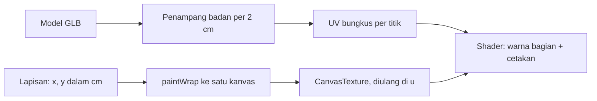
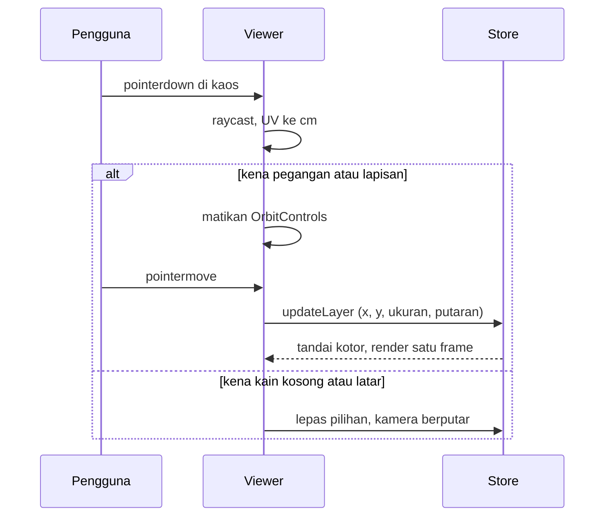
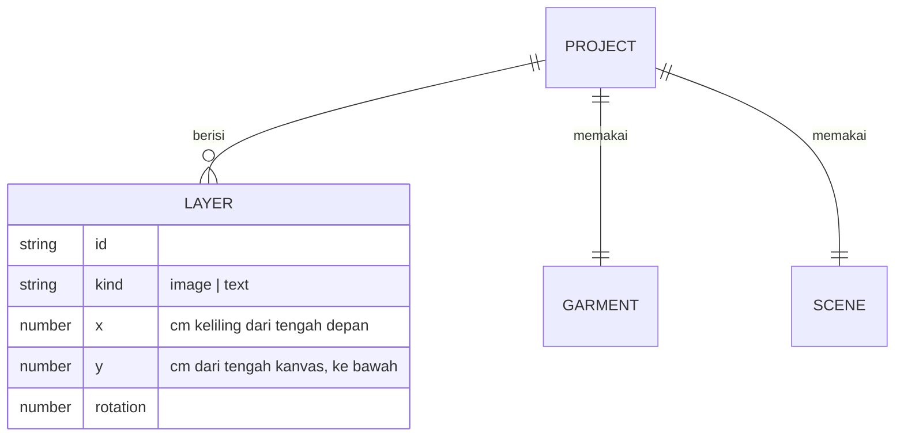

# Editor 3D: dua kolom, edit langsung di kaos, performa

| | |
|---|---|
| Tanggal | 19 November 2026 |
| Status | Dikerjakan |
| Keputusan pemilik produk | Gambar dan tulisan boleh menyambung melewati jahitan (depan, sisi, belakang, lengan, kerah). antislop mode DURING. |

## Masalah dari pengguna

1. Editor punya tiga area (opsi, kanvas desain 2D, pratinjau 3D). Diminta dua: opsi di kiri, pratinjau 3D di kanan.
2. Lapisan dibuka dari satu tombol di pratinjau: urutkan dengan seret, edit, hapus.
3. Semua pengeditan terjadi di pratinjau 3D: geser, ubah ukuran, putar. Gambar panjang bisa melingkar dari depan ke belakang, lengan, atau kerah.
4. Editor terasa berat dan patah-patah, terutama di tablet.

## Hasil review (sebelum perubahan)

| Temuan | Lokasi | Dampak |
|---|---|---|
| Setiap perubahan state (termasuk tiap gerakan seret) men-`JSON.stringify` seluruh proyek, termasuk gambar data URL | `lib/store.ts` (`createJSONStorage`), `lib/idb-storage.ts` | Diukur: 311 ms waktu CPU untuk 40 gerakan seret dengan satu foto 8,5 MB (desktop). Di tablet 4 sampai 6 kali lebih lambat |
| Render 3D jalan terus 60 kali per detik walau tidak ada yang berubah | `components/editor/Viewer.tsx` loop `setAnimationLoop` | Diukur: 1.080 draw call per 2 detik saat diam. GPU tablet panas dan bersaing dengan UI |
| Tiap perubahan menggambar ulang tiga kanvas cetak dan mengunggah ketiganya ke GPU | `Viewer.tsx` `repaint()` | Diukur: 120 unggahan tekstur untuk 40 gerakan seret |
| Kanvas desain 2D juga menggambar ulang tiap gerakan | `components/editor/DesignCanvas.tsx` | Kerja ganda untuk satu perubahan |
| Kualitas awal "Tinggi" di semua perangkat (kanvas 4096 px, rasio piksel 2, bayangan) | `lib/slices/ui.ts` | Berat untuk GPU tablet sejak awal |
| Lapisan terikat ke satu sisi (`zone`), UV cetak per bagian | `lib/print.ts`, `lib/garment.ts` | Tidak bisa menyambung lewat jahitan |
| Urutan lapisan memakai `draggable` HTML | `DesignPanel.tsx` `LayersPanel` | Tidak jalan dengan sentuhan di banyak tablet |

Alat ukur: build produksi (`next build` + `wrangler dev`), Playwright dengan CDP Profiler, GPU Intel UHD 730. Chrome DevTools MCP di sesi ini hanya punya `navigate`, `evaluate`, `screenshot` (tanpa trace performa), jadi profil CPU diambil lewat CDP dari Playwright.

## Rencana

### Kanvas cetak yang membungkus kaos

Satu kanvas cetak untuk seluruh kaos. Sumbu x = keliling badan (96 cm, 0 = tengah depan, plus atau minus 48 = tengah belakang). Sumbu y = tinggi (75 cm). Setiap titik model (badan, lengan, kerah) dipetakan dari posisinya: sudut pada elips penampang badan di ketinggian itu, dikoreksi menjadi panjang busur supaya skala depan dan sisi sama. Karena UV hanya bergantung pada posisi, cetakan menyambung di setiap jahitan.

- Segitiga yang melintasi tengah belakang (u melompat dari 1 ke 0) digeser ke u lebih dari 1, tekstur memakai `RepeatWrapping`.
- Kanvas transparan. Warna kain tiap bagian (badan, lengan, kerah) diatur lewat warna material, cetakan dicampur di atasnya.
- Lapisan dekat tepi kanvas digambar dua kali (geser 96 cm) supaya menyambung di tengah belakang.

### Edit di pratinjau 3D

- Kotak seleksi, empat pegangan sudut, dan pegangan putar digambar di tekstur, jadi ikut melengkung di permukaan kaos. Ukurannya mengikuti jarak kamera.
- Lapisan baru muncul di titik kaos yang menghadap kamera (raycast dari tengah layar).
- Padanan keyboard tetap: panah menggeser 1 mm (Shift 1 cm), kolom di bilah konteks untuk ukuran dan putaran, Hapus, Ctrl+D, Ctrl+Z.

### Tata letak

- Lebar 1024 px ke atas: kiri = rel alat + panel opsi, kanan = pratinjau 3D. Bilah pengaturan lapisan melayang di atas area 3D.
- Di bawah 1024 px: pratinjau 3D di atas, bilah pengaturan lapisan di bawah area 3D (dekat jempol), lalu rel alat dan panel opsi.
- Di kedua tata letak ukuran kanvas 3D tidak berubah saat bilah berganti isi, jadi kaos tidak bergeser di bawah jari saat lapisan dipilih.
- Tombol Lapisan di bilah itu membuka panel lapisan di atas pratinjau.
- Panel lapisan: pilih (edit), seret pegangan untuk mengurutkan (pointer, jadi jalan dengan sentuhan), Alt+panah atau tombol Ke Depan/Ke Belakang sebagai padanan keyboard, Hapus.

### Performa

| Perbaikan | Cara |
|---|---|
| Tanpa `JSON.stringify` tiap perubahan | Storage persist menyimpan objek langsung ke IndexedDB (structured clone), sekali per 500 ms diam |
| Render sesuai kebutuhan | Gambar ulang hanya saat kamera bergerak, store berubah, atau animasi kamera berjalan |
| Satu kanvas cetak | Satu `repaint` dan satu unggahan tekstur per frame berubah |
| Kualitas awal per perangkat | Pointer kasar (tablet, ponsel) mulai di "Sedang" |

## Data

Migrasi persist versi 3: `zone` dihapus. Depan tetap di x, belakang digeser 48 cm, lengan kiri dan kanan ke sisi (plus atau minus 24 cm). y dipindah ke pusat kanvas.

## Hasil yang diharapkan

- [x] Editor dua kolom di 1024 px ke atas, menumpuk rapi di ponsel tanpa geser horizontal
- [x] Klik lapisan di kaos 3D memilihnya, seret memindahkan, sudut mengubah ukuran, bulatan atas memutar
- [x] Gambar lebar menyambung dari depan ke belakang tanpa garis di tengah belakang
- [x] Cetakan bisa ditaruh di lengan dan kerah
- [x] Panel lapisan: urut dengan seret (mouse dan sentuhan), pilih, hapus, bisa dengan keyboard
- [x] Saat diam tidak ada draw call baru
- [x] Waktu `setItem` saat seret turun ke mendekati nol
- [x] `pnpm check`, `pnpm lint`, `pnpm typecheck`, `pnpm build` lulus
- [x] Proyek lama (versi 2) terbuka dengan lapisan di tempat yang masuk akal

## Hasil verifikasi (19 November 2026)

Build produksi (`next build` + `wrangler dev`), Chrome lewat Playwright MCP, GPU Intel UHD 730. Satu foto 8,5 MB (4000 x 3000 px) di proyek, 40 gerakan seret.

| Ukuran | Sebelum | Sesudah |
|---|---|---|
| Draw call saat diam, 2 detik | 1.080 | 0 |
| Waktu CPU `setItem` selama seret | 311 ms | 0 ms |
| Unggahan tekstur kanvas selama seret | 120 | 41 (satu per frame yang berubah) |
| Long task (lebih dari 50 ms) selama seret, CPU normal dan 4 kali lebih lambat | tidak diukur | 0 dan 0 |
| Waktu raycast selama seret, CPU normal / 4 kali lebih lambat | tidak ada | 20 ms / 75 ms (sekitar 0,5 / 1,9 ms per gerakan) |
| Kualitas awal di perangkat sentuh | Tinggi | Sedang |

Uji fungsi (Playwright MCP):

| Uji | Hasil |
|---|---|
| Proyek versi 2 dari profil browser lama | Terbuka sebagai versi 3, `zone` hilang, tersimpan sebagai objek (bukan teks JSON) |
| Seret gambar di kaos | Pindah ke bahu dan menyambung ke lengan, kotak seleksi ikut melengkung |
| Pegangan putar | `rotation` 0 ke 64 |
| Pegangan sudut | Ukuran tulisan berubah (kiri atas ditarik ke dalam: 6 ke 0,94 cm) |
| Undo setelah seret | Satu gerakan seret = satu langkah undo, termasuk seret dengan jeda 700 ms |
| Panah dan Shift+panah | x +0,1 cm, y -1 cm |
| Gambar lebar 90 cm | Tampak dari depan, kiri, belakang, menyambung di tengah belakang tanpa garis |
| Tulisan di samping dan belakang | Terbaca normal (tidak terbalik) |
| Panel lapisan: seret pegangan | Garis sisip tampil, urutan TIGA DUA SATU menjadi SATU TIGA DUA, diumumkan lewat live region |
| Panel lapisan: Alt+panah bawah | Pindah satu posisi, fokus tetap di pegangan, posisi diumumkan |
| Hapus di panel lapisan | Fokus pindah ke baris berikutnya, atau ke Tutup bila kosong |
| Escape di panel lapisan | Panel tertutup, fokus kembali ke tombol Lapisan |
| Ukuran kanvas saat lapisan dipilih | Tetap (1280 x 800, 820 x 1180, 390 x 844) |
| Seret sentuh, tablet 820 x 1180 dan ponsel 390 x 844 | Lapisan pindah. Tablet 46 fps dengan CPU 4 kali lebih lambat |
| Geser horizontal halaman, 390, 820, 1280 px | Tidak ada |
| Ekspor PNG 2048 px | Tanpa kotak seleksi |
| Error console dan pageerror | 0 |

Pemeriksaan Chrome DevTools MCP (alat yang tersedia: `navigate`, `evaluate`, `screenshot`): grid `96px 300px 1fr` dengan area `rail panel preview`, bilah melayang (`position: absolute`), kontras teks petunjuk 6,9:1, `touch-action: none` di kanvas, tidak ada resource gagal, load 192 ms (lokal), unduhan 1.122 KB (model 740 KB), heap JS 15 MB. Trace performa dan Lighthouse tidak tersedia di MCP ini, jadi profil CPU diambil lewat CDP Profiler dari Playwright.

`pnpm check` menambah tes: UV bungkus (tengah depan, sisi, panjang busur pada lingkaran, segitiga tengah belakang), hit test lintas tengah belakang, pegangan putar dan sudut, migrasi versi 2, satu langkah undo saat seret.

### Batasan yang diketahui

- Lengan dipetakan lewat elips badan, jadi cetakan yang masuk ke lengan sedikit melebar. Perbaikan berikutnya: UV dari pola kain model.
- Di dekat hem, keliling badan sekitar 13% lebih besar dari 96 cm, jadi cetakan di sana tampak sedikit lebih lebar dari ukuran cm-nya.
- Di ponsel, setelah menambah lapisan dari panel di bawah, pengguna perlu menggulir ke atas untuk melihat kaos bila halaman sudah tergulir.
- Gambar editor di halaman depan (`public/editor-preview.jpg`) dan teks alt-nya masih menunjukkan tata letak tiga kolom lama.
